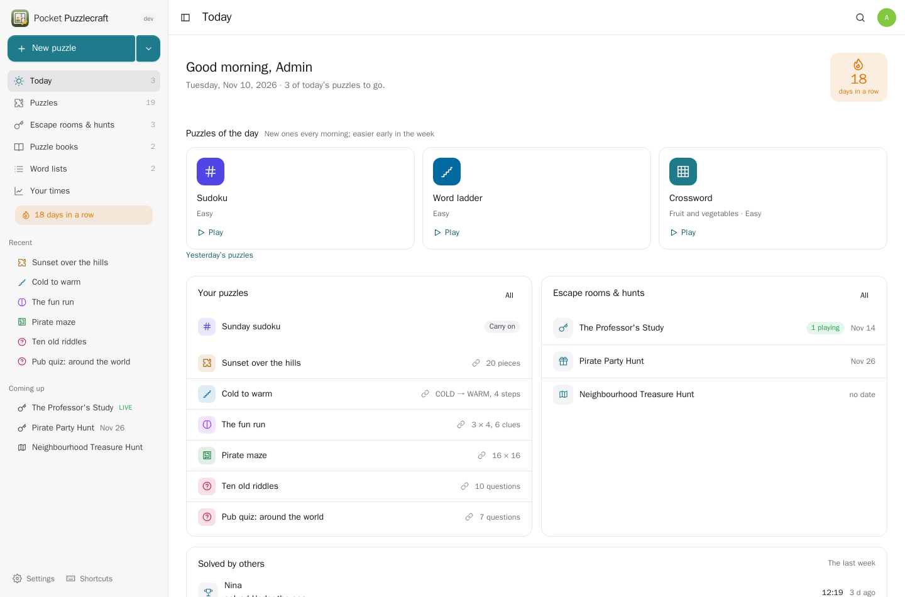
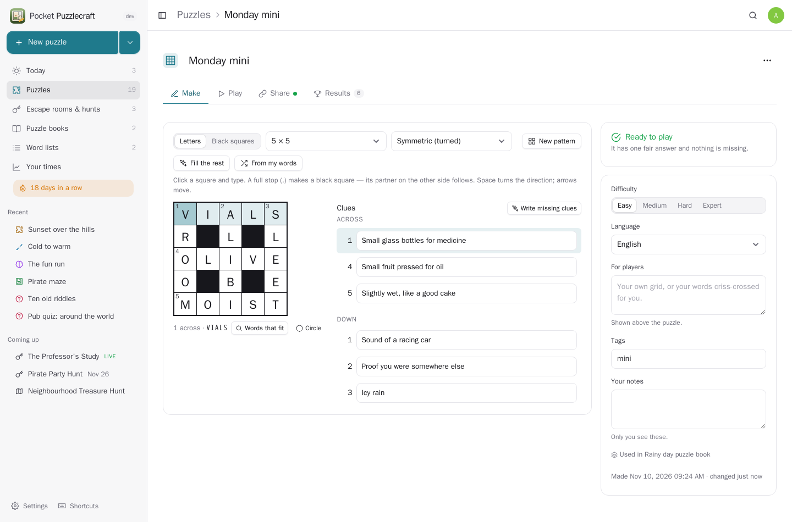
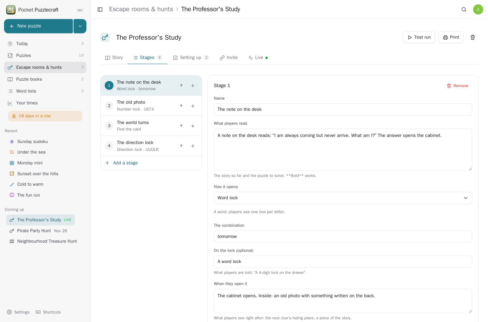
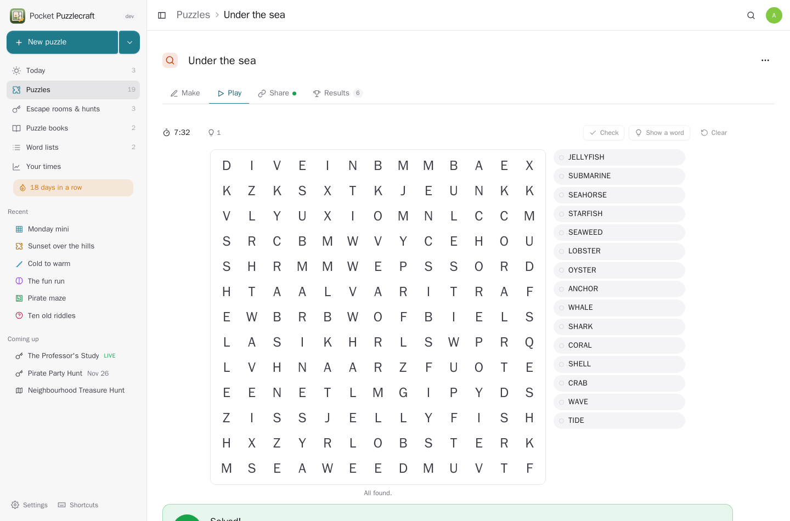
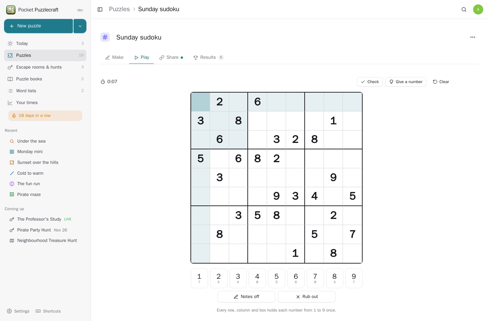
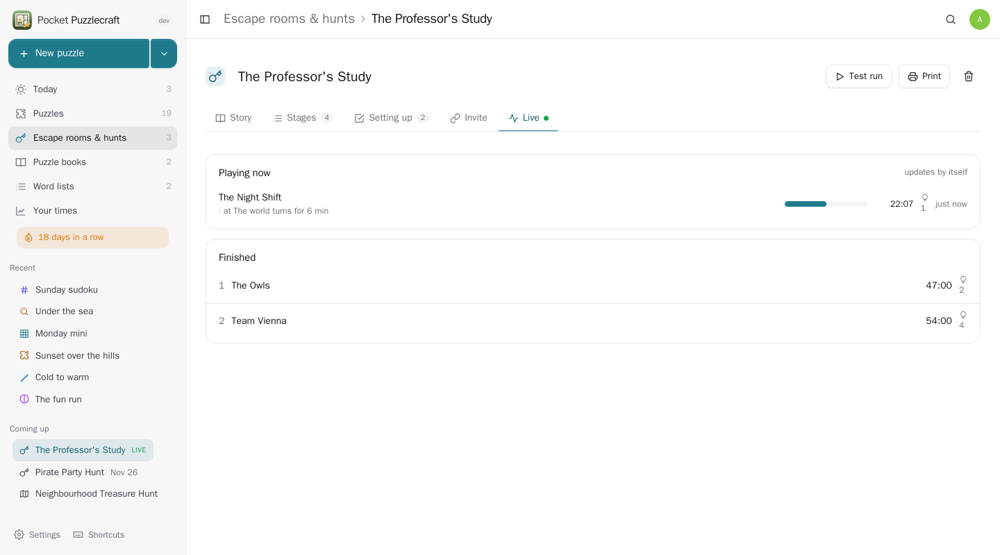
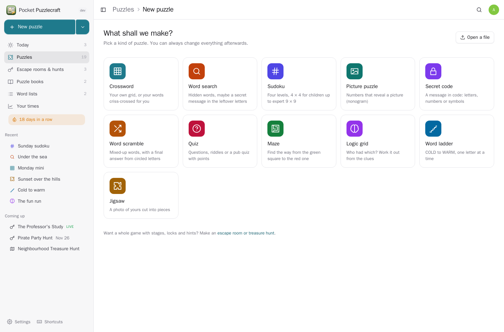
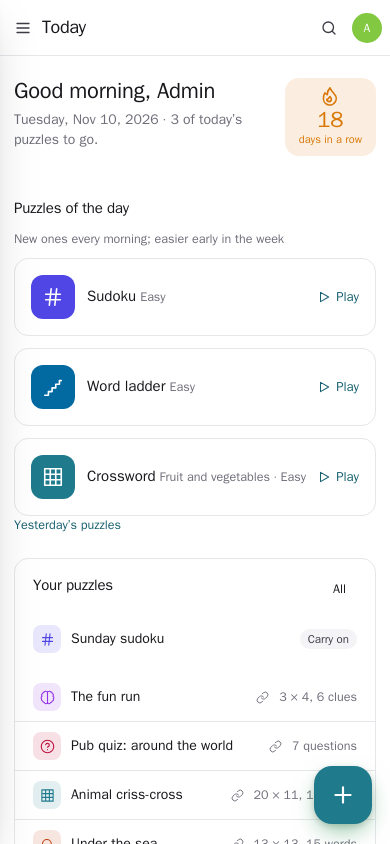
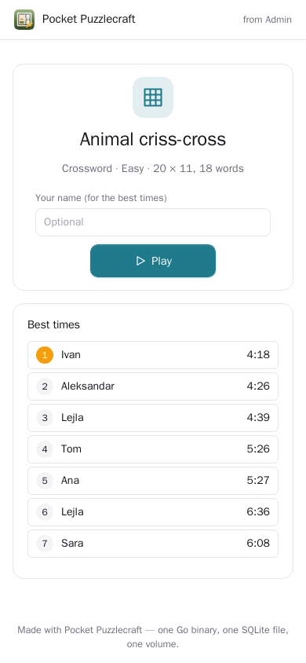
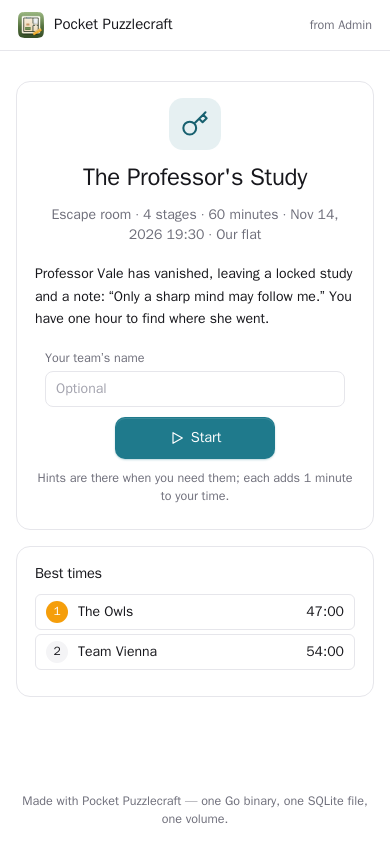

<p align="center"></p>

<h1 align="center">Pocket Puzzlecraft</h1>

<p align="center">Make puzzles and share them: crosswords, word searches, sudoku, picture puzzles, secret codes, word scrambles, quizzes, mazes, logic grids, word ladders and photo jigsaws — each tested for one fair answer, printable with its answer key, and playable by anyone through a link. Puzzle books, puzzles of the day, and whole escape rooms and treasure hunts with locks, QR cards and hints.<br>One Go binary, one SQLite file, one volume. Part of the Pocket apps; works on its own too.</p>

<p align="center">
  <a href="https://github.com/abjelosevic88/pocket-homelab-puzzlecraft/actions/workflows/ci.yml"></a>
  <a href="https://github.com/abjelosevic88/pocket-homelab-puzzlecraft/pkgs/container/pocket-homelab-puzzlecraft"></a>
  <a href="LICENSE"></a>
</p>

<p align="center"></p>

<table>
  <tr>
    <td width="50%"></td>
    <td width="50%"></td>
  </tr>
  <tr>
    <td align="center"><sub>Make a crossword: type into the grid, black squares stay symmetric, words that fit, “fill the rest”, AI clues — and the test says when it is fair.</sub></td>
    <td align="center"><sub>Escape rooms and hunts: stages with number, word, arrow and colour locks, QR cards to hide, puzzles to solve, timed hints.</sub></td>
  </tr>
  <tr>
    <td width="50%"></td>
    <td width="50%"></td>
  </tr>
  <tr>
    <td align="center"><sub>Play anything in the browser: a word search with a hidden message in the leftover letters…</sub></td>
    <td align="center"><sub>…a sudoku with pencil notes, a picture puzzle, a secret code, a logic grid, a jigsaw.</sub></td>
  </tr>
  <tr>
    <td width="50%"></td>
    <td width="50%"></td>
  </tr>
  <tr>
    <td align="center"><sub>Host view: every team, the stage they are at, their time and hints, updating by itself.</sub></td>
    <td align="center"><sub>Eleven kinds, made for you from your words, a ready-made list or the AI — or by hand.</sub></td>
  </tr>
</table>

<table>
  <tr>
    <td width="33%"></td>
    <td width="33%"></td>
    <td width="33%"></td>
  </tr>
</table>

## What it does

- **Eleven kinds of puzzle.** Crosswords (a classic grid with symmetric black squares, or your words criss-crossed for you), word searches (with a hidden message in the leftover letters), sudoku (4 × 4 for children to expert 9 × 9, diagonal too), picture puzzles (nonograms — draw one, take a ready-made one, or turn a photo into one), secret codes (mixed letters, Caesar shift, numbers, symbols), word scrambles (with a final answer from circled letters), quizzes and riddles (choices, typed answers, numbers, true/false, pictures, points), mazes, logic grids (“who had which?”), word ladders and photo jigsaws.
- **Made for you, or by hand.** From your own words and clues, a word list, a ready-made list (animals, space, the kitchen, Bosnian/Croatian/Serbian lists…), or Pocket AI (words on any topic, clues, quiz questions). A crossword editor with words that fit, “fill the rest” and AI clues.
- **Tested.** Every puzzle is checked for one fair answer: sudoku solved and rated, picture puzzles solved line by line, logic clues searched for a unique answer, crossword words and clues, word-search words that fit, the hidden message.
- **Play anywhere.** In the app or through a share link — no account needed: a clock, hints that count, mistakes marked, progress kept, best times. The answer never leaves the server.
- **Puzzles of the day.** A sudoku, a word ladder and one more every day (easier early in the week), and your run of days.
- **Escape rooms, treasure hunts, mysteries, party games.** Stages with a story, a picture and a lock — answer, number lock, word lock, direction lock, colour lock, a QR card to find, or one of your puzzles; hints that come after some minutes; a time limit and hint penalties; ready-made stories (The Professor’s Study, a birthday mystery, a pirate party hunt, a town hunt) or written by the AI; a setting-up list; printable stage cards, QR cards and a host sheet; a test run; the host’s live view of every team.
- **Puzzle books** to print (answers at the back, large print) or share as one link. **Word lists** to build from. **Your times** by kind.
- **Bosnian, Croatian and Serbian** puzzles keep LJ, NJ and DŽ in one square.
- **Files:** opens Across Lite `.puz` and `.ipuz` crosswords and sudoku (or 81 digits); downloads `.puz` and `.ipuz`.

## Run it

```sh
docker run -d --name pocket-puzzlecraft -p 8080:8080 -v ./data:/data \
  -e BASE_URL=https://puzzles.example.com -e SECURE_COOKIES=true \
  ghcr.io/abjelosevic88/pocket-homelab-puzzlecraft:latest
```

Open it and make the first account (that one is the admin). To try it with made-up puzzles: `DEMO_DATA=true AUTH_MODE=none`. Release binaries for Linux, macOS, Windows and FreeBSD are on the releases page. Settings: [docs/configuration.md](docs/configuration.md), API: [docs/api.md](docs/api.md), backup: [docs/backup.md](docs/backup.md).

## With Pocket Core

Set `CORE_URL` and `CORE_REGISTRATION_KEY` and Puzzlecraft joins the box: people sign in with Pocket Core, Pocket AI helps, and through app links (each person switches them on) it reaches the other Pocket apps — every one optional, greyed out with what to do when it is not there:

| App | In Puzzlecraft | Scopes |
|---|---|---|
| Pocket Calendar | a puzzle night, an escape room or a hunt in the calendar, with the link | `calendar:read`, `calendar:write` |
| Pocket Contacts | the people to email a puzzle or an invitation to | `contacts:read` |
| Pocket Chat | send a puzzle to a chat as a card to tap and play | `chat:read`, `chat:write` |
| Pocket Email | an invitation or a puzzle from your own mail account | `mail:send` |
| Pocket Photos | jigsaws, quiz pictures, escape-room pictures from your photos | `photos:read` |
| Pocket Files | `.ipuz` files of crosswords and sudoku | `files:write` |
| Pocket Notes | answer keys and escape-room host sheets | `notes:write` |
| Pocket Tasks | an escape room’s setting-up list, due the day before | `tasks:write` |
| Pocket Inventory | props you already have (padlocks, boxes, torches) | `items:read` |
| Pocket Places | treasure-hunt stops from your saved places | `places:read` |
| Pocket Map | the hunt’s stops on your map | `map:write` |
| Pocket Learn | a puzzle’s words and clues, or a word list, as flashcards | `learn:read`, `learn:write` |
| Pocket Bookshelf | a quote from a book as a secret code | `books:read` |
| Pocket Habits | your puzzle habit ticked when you solve today’s puzzle | `habits:read`, `entries:write` |
| Pocket Quest | a puzzle as a handout in a tabletop campaign | `quest:read`, `quest:write` |
| Pocket Blog | a draft post with the puzzle and its link | `blog:write` |
| Pocket Family | a puzzle pinned to the family board | `family:read`, `family:write` |
| Pocket Translate | a copy with the clues and questions translated | `translate:run` |
| Pocket Alerts | an alert when someone finishes what you shared | `alerts:write` |

Other apps use your puzzles through `puzzlecraft:read` and `puzzlecraft:write` (never the answers): Pocket AI answers “how many puzzles did I solve this week?” or “make me a hard sudoku”, Pocket Search finds puzzles and games, Pocket Day shows what you solved. Events for Pocket Flows: `puzzlecraft.puzzle_created`, `puzzle_shared`, `puzzle_solved`, `daily_solved`, `adventure_created`, `adventure_finished`.

## Develop

```sh
make run      # build the web app and the binary, start with demo data on :8080
make dev      # Go server + Vite dev server
make test     # go vet, go test, tsc
```

Go 1.26, `modernc.org/sqlite` (no CGO), chi; React 19, TypeScript, Vite. The puzzle engine (making, solving, checking every kind) is `internal/puzzle`, with no database or HTTP in it. The English word list is ENABLE (public domain); the everyday-word ranking is `popular.txt` from [dolph/dictionary](https://github.com/dolph/dictionary).

MIT © 2026 Aleksandar Bjelosevic
